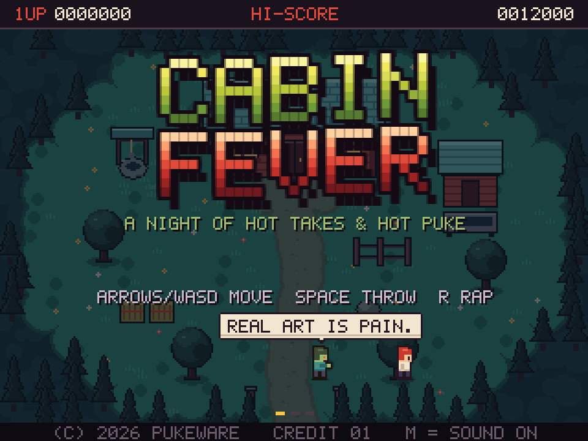

# Cabin Fever

As the epic trip to Vierumäki was postponed due to norovirus, made this game instead :)

An 8-bit top-down survival game. A puking zombie with strong opinions chases you around a cabin. Survive until 6:00 AM, then escape. Five levels.

**[▶ Play it in your browser](https://jussikauhanen.github.io/cabin-fever/)** (keyboard or touch, no install)

[](https://jussikauhanen.github.io/cabin-fever/)

## Levels

| # | Level | Night | Who chases you |
| --- | --- | --- | --- |
| 1 | The cabin | 70 s | Zombies |
| 2 | The clearing | 90 s | Zombies |
| 3 | The deep forest, somewhere in Finland | 110 s | A harmless **mushroom granny** picks mushrooms while zombies and the **bear** arrive. Protect her: a zombie bite turns her into a mushroom-throwing zombie. |
| 4 | Kontula, East Helsinki | 130 s | Arriving through the night: a zombie and the **spurgu**, then two zombies, then the **nisti**, then the rest of the zombies |
| 5 | Kontula metro, on the platform | 140 s | Zombies and the **ticket inspector** arrive while trains rush through. At 6:00 AM, board the first train. |

The night (12:00 to 6:00 AM) passes fastest on level 1 and a little slower on each level after it. On levels 3 to 5 a new arrival comes every 15–16 seconds; a zombie slot only fills if your zombie count has that many zombies, so the fewer times you have been caught, the emptier the night.

- **Bear:** growls, then charges in a straight line and needs a breather.
- **Mushroom granny:** starts harmless, wandering and picking chanterelles. Keep zombies away from her. A bite starts a visible transformation countdown; once turned, she chases you and warns before throwing mushrooms that make you slip. Dodged mushrooms land at the marked spot and break into small slippery pieces, which disappear after three seconds. Keep her unbitten until sunrise for a bonus (`grannySafeBonus` in `js/config.js`).
- **Spurgu:** very slow; wobbles, naps on the spot (harmless while asleep) and spills slippery beer.
- **Nisti:** really fast, faster than you while dashing, but twitches in place between dashes and drifts off now and then.
- **Ticket inspector:** never catches you, but fines you on contact: two magazines, or 100 points if you have none. Between fines he checks the zombies' tickets, which stops them for a moment.

### The metro platform

Every 8–12 seconds the bell rings and the edge lights flash amber: a train is coming on that track (track 1 runs right, track 2 runs left). Anything on the rails gets hit. Zombies are knocked into the tunnel for 200 points and climb back out at a far platform end ten seconds later. The inspector is only grazed: he lands on the platform, dizzy for a few seconds. If it hits you, you count as caught. Throw a magazine onto the rails to lure zombies there. The announcer chimes in now and then. At 6:00 AM the first train pulls into track 2 and opens its doors; walk into a door from the lower platform to escape. The level has its own fast arcade-action tune. Tune the `train*`, `inspector*` and `announceEvery` values in `js/config.js`.

### Checkpoints

Every level hides a checkpoint flag behind something tall (a bookshelf, a tree, a birch, a pillar). Walk behind it to pick the flag up; a faint twinkle gives the spot away. If you then lose every life, the game over screen lets you retry the level of the last flag you found, with fresh lives and the score you had when you started that level, or give up and save your score. A used flag is back in its hiding place for the next try.

Magazines and raps distract the hostile characters. The bear eats the magazine instead of reading it, the infected granny reads for longer, and the nisti loses interest fast. The healthy picker ignores magazines, so use them to keep zombies busy and away from her; raps give everyone a breather.

## Play

- **Online:** [jussikauhanen.github.io/cabin-fever](https://jussikauhanen.github.io/cabin-fever/), served by GitHub Pages from `main` (root folder).
- **Locally:** open `index.html` in a browser. No build step, no server needed.

## Controls

| Key | Touch | Action |
| --- | --- | --- |
| Arrows / WASD | Drag the stick | Move |
| Space | THROW | Throw an art or dance magazine (zombies stop to read) |
| R | RAP | Rap, if you've found a mic (type the line before time runs out) |
| P / Esc | Pause button | Pause |
| R (while paused) | RESTART (pause menu) | Restart the game from level 1 |
| M | Speaker button | Sound on/off |
| Enter | Yellow button, or tap the screen | Start / continue |

### On a phone or tablet

Portrait puts the controls under the game screen; landscape puts the stick on the left and the buttons on the right. The stick appears wherever your thumb lands. The full screen button (where the browser allows it) trims the margins so the game screen grows. Raps and high score initials use one full-width on-screen keyboard in both orientations, with the line to type shown at double size right above it and the next key lit up (`touchRapHint` in `js/config.js`). On the title screen, swipe the game screen to flip pages. Rap lines get 80% more time when typed by touch (`touchRapSlack` in `js/config.js`); a hardware keyboard keeps the original timing.

On desktop, rapping keeps the game screen at its normal size, with the on-screen keyboard overlaid at the bottom and the original rap panel above it. Pausing the game also pauses the music, which continues when you resume. On-screen hints switch between key names and button names depending on what you last used.

Get caught and you turn into a zombie: the level restarts with one more zombie. Five and it's game over.

During play, checkpoint and status notices stay in a compact strip below the HUD. One speech bubble follows its speaker at a time, keeping the same side and size for the whole line. Bubbles and notices become more transparent when characters or hazards pass underneath.

## Project layout

```
index.html      page + script load order
css/style.css   page and touch control styles (the game itself draws on a canvas)
js/             game code, one topic per file
screenshots/    images for this README (not used by the game)
```

Want to change or add something? See [EXTENDING.md](EXTENDING.md).
